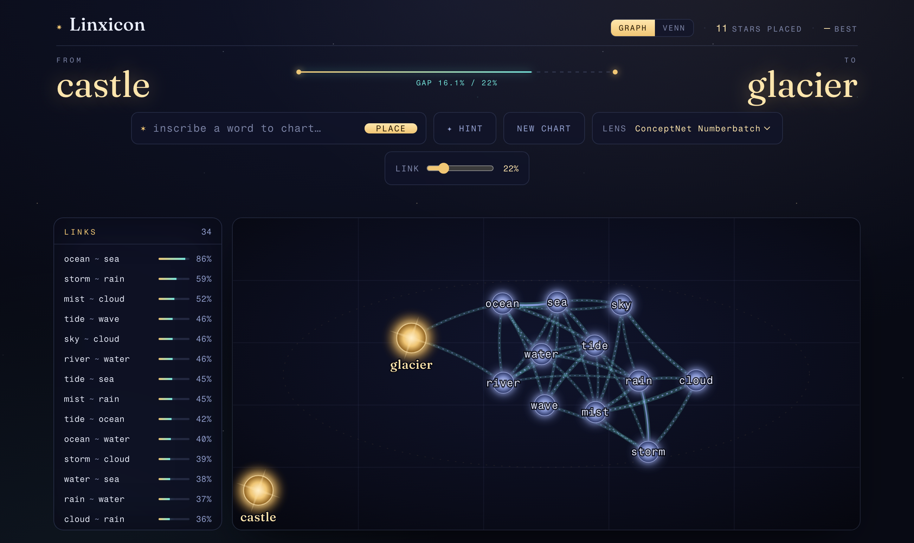
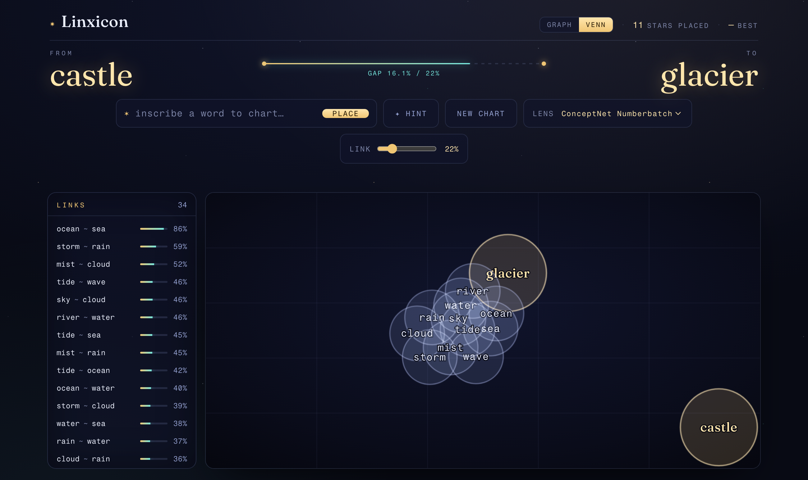
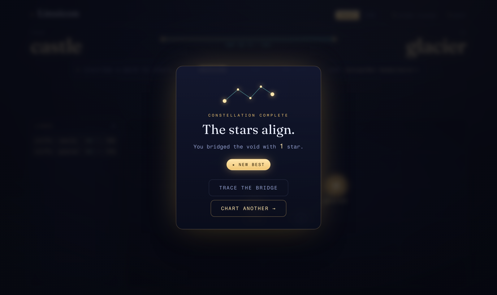

# Linxicon (clone)

> **Disclaimer — this is an unofficial fan recreation.** Linxicon is a daily word
> game by its original creators, playable at **[linxicon.com](https://linxicon.com/)**.
> This repository is an independent clone built for learning and experimentation. It
> is not affiliated with, endorsed by, or connected to the original in any way. All
> credit for the original concept goes to the Linxicon team — please go play the real
> thing at [linxicon.com](https://linxicon.com/).

Bridge two unrelated words by adding intermediate words to a living map of meaning.
Two words auto-connect when their semantic similarity clears the active threshold; you
win by connecting the two targets — using as few words as possible.

| Constellation (graph) view | Atlas (venn) view |
| --- | --- |
|  |  |

<p align="center">
  
</p>

> Screenshots are captured headlessly via the Chromium engine (Chrome DevTools
> Protocol) — see the drivers under the project's screenshot tooling.

## Features

- **Two views, one game.** A `Graph | Venn` toggle in the header swaps between a
  force-directed constellation and an **Euler cloud** where each word is a translucent
  circle and overlap depth encodes similarity. Both render the same live board; the
  active view is reflected in the `?view=` URL.
- **Links panel.** A live list down the left of every connected word pair and its
  similarity %, sorted strongest-first.
- **Hint.** Suggests the dictionary word that best bridges the current weakest link
  under the active model and threshold, then places it.
- **Animated result reveal.** On a win, the widest bridge path A→B lights up one word
  at a time before the win modal appears.
- **Adjustable threshold.** A `link %` slider re-scores the board live so you can test
  how connectivity changes per model — no re-embedding.
- **Per-game persistence.** Placed words are saved to `localStorage` per puzzle, so a
  reload restores your board.
- **Draggable nodes with localized physics.** Dragging a node only disturbs it and its
  direct connections; the rest of the map holds still, and the release eases rather
  than snapping.

## Run it locally

The app is **two processes**: the Vite frontend (`:5173`) and the embeddings API
(`:8787`). Vite proxies `/api` → `:8787`. If the API isn't running you'll see
"Could not reach the word service." in the UI.

```bash
npm install
./run.sh           # starts BOTH the frontend and the API together
# or run them separately:
npm run dev        # frontend only  → http://localhost:5173
npm run dev:api    # embeddings API → http://localhost:8787
```

Other `run.sh` commands: `test`, `watch`, `check`, `build`, `preview`, `all`.

```bash
npm test           # vitest
npm run check      # type-check (svelte-check + tsc, app/node/server)
npm run build      # static build to dist/
```

## How it works

- `src/lib/engine/` — pure-TypeScript game engine: holds the word graph, forms an edge
  between any two words whose cosine similarity is ≥ the threshold, and computes the
  "gap" between the two targets as the maximum-bottleneck (widest) path over all
  pairwise similarities. Also exposes the bridge path (for the reveal) and the weakest
  link (for hints).
- `server/` — a Fastify embeddings service. It serves `/api/embed` (vectors from
  quantized ConceptNet Numberbatch + MiniLM tables, with live MiniLM fallback) and
  `/api/hint` (best bridging dictionary word between two anchors).
- `src/lib/embeddings.ts` — client to that API, with an in-memory + IndexedDB vector
  cache (`src/lib/embedder.ts`).
- `src/lib/models.ts` — per-model similarity thresholds (Numberbatch runs colder than
  MiniLM); the UI can override these at runtime.
- `src/lib/game.ts` — Svelte store wiring everything together; persists stats and
  per-puzzle words to `localStorage` (`src/lib/stats.ts`, `src/lib/savedGames.ts`).
- `src/components/` — `Graph.svelte` (constellation), `VennBoard.svelte` (Euler cloud),
  `LinksPanel.svelte`, `Hud.svelte`, `WinModal.svelte`.

## Credits

Original game and concept: **[Linxicon](https://linxicon.com/)**. This clone is an
independent reimplementation for educational purposes.
